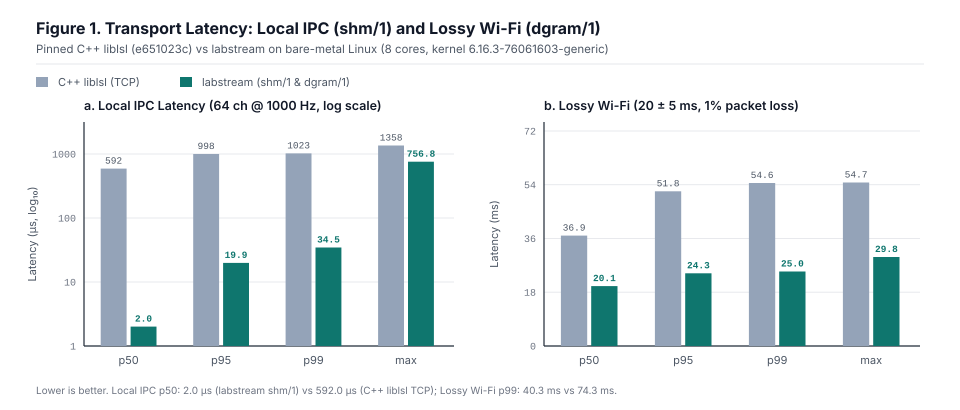
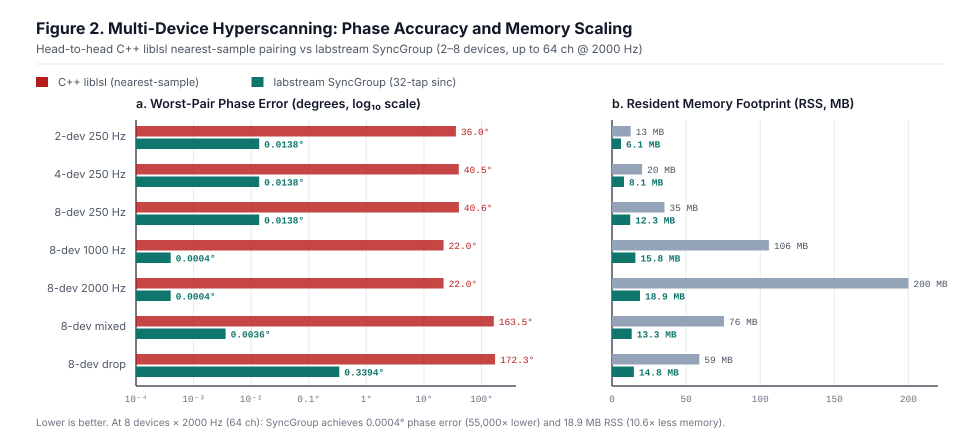

# labstream

The Lab Streaming Layer, in Rust.

This library speaks the protocol of the C++ library at `sccn/liblsl`. An
unchanged application that was written for liblsl runs on it. pylsl,
LabRecorder, and a third-party recorder each do so.

## Status

This is version 0.2.0, and it is on crates.io. The protocol work is complete
and measured. These crates can change before version 1.0. liblsl fixes the C
ABI, so the C ABI will not change. `docs/versioning.md` gives the full rule.

| Measure | Result |
|---|---|
| C symbols exported | 165 of 165, none a stub |
| Example programs of liblsl that link and agree | 21 of 21 |
| XPath queries answered as the oracle answers them | 42 of 42 |
| Longest recording | 7.81 hours, 8.4 million samples, no loss |
| Tests in this repository | 508 |

The conformance workbench in `conformance/` made each measurement against a
pinned build of liblsl at commit `e651023c`. `docs/conformance.md` gives the
method and the full result.

## Layout

| Path | What it holds |
|---|---|
| `crates/` | every crate, one directory for each crate |
| `conformance/` | the tools that measure the crates against liblsl, and their records |
| `conformance/liblsl/` | the pinned C++ library, a git submodule |
| `docs/` | the layout of the repository, the release steps, the version rule, the extensions, and the conformance result |
| `demos/` | seven standalone interactive demos (`demos/README.md`) |
| `web/` | the browser WebSocket and WebAssembly viewer (`labstream.js`, `index.html`) |
| `SPEC.md` | the protocol, with a citation for every claim |

One Cargo workspace holds every crate. A crate takes another crate of this
repository by path and by version. The workspace builds against the path, and
the published crate asks crates.io for the version.

## The crates

| Crate | What it holds | Touches the operating system |
|---|---|---|
| `labstream` | the API that a Rust program calls | through `labstream-net` |
| `labstream-core` | the four crates below, as one dependency | through `labstream-net` |
| `labstream-wire` | the sample codec | no |
| `labstream-proto` | the handshake, discovery, and time sync | no |
| `labstream-time` | the timestamp filter, bit exact | no |
| `labstream-net` | sockets, outlet, inlet, resolver, configuration, XPath | yes |
| `labstream-capi` | the C ABI, built as `liblsl.so` | yes |
| `labstream-cli` | the `labstream` command-line tool (`doctor`, `top`, `play`, `relay`, `calibrate`) | yes |
| `labstream-wasm` | the `wasm32-unknown-unknown` browser wire decoder | no |

`labstream-core` holds no code. It names the four crates below it, so a program
takes one dependency. `labstream-capi` is not one of them, because it builds a
shared library for a C program and gives a Rust program nothing.

`labstream` holds no protocol code. It calls `labstream-net` and
`labstream-wire`, and it gives a Rust program block reads, a channel list, a
query builder, and one error type. `crates/labstream/docs/design.md` gives why
it is a separate crate.

`lsl-peer`, in `conformance/peer/`, is a tool of the workbench and not a
library. It is not on crates.io.

Only `labstream-net` touches the operating system. `labstream` and
`labstream-capi` reach it through `labstream-net`. A protocol rule therefore
gets a unit test with a byte slice.

## Add the library to a Rust program

Most programs want [`labstream`](https://crates.io/crates/labstream). That
crate is the API: it holds the block reads, the channel list, the query
builder, and the error type.

```sh
cargo add labstream
```

`crates/labstream/README.md` gives examples of that API.

If a program needs a protocol detail that the API does not give, use the
protocol crates directly.

```sh
cargo add labstream-core
```

That one line gives every part:

```rust
use labstream_core::net::{clock, Outlet, StreamInfo};
use labstream_core::wire::{Format, Sample, Value};
```

A program that opens no socket can drop the one crate that does:

```toml
[dependencies]
labstream-core = { version = "0.2", default-features = false }
```

`labstream-wire`, `labstream-proto`, and `labstream-time` stay. Each one holds
no input and no output, so it costs a program nothing.

A program that wants one part alone can still name that part alone:

```sh
cargo add labstream-wire
```

`labstream-capi` is not on crates.io. It builds a shared library for a C
program, and a Rust program cannot link it. The next section gives how to get
it.

### Send samples

```rust
use labstream_core::net::{clock, Outlet, StreamInfo};
use labstream_core::wire::{Format, Sample, Value};
use std::time::Duration;

fn main() -> std::io::Result<()> {
    let info = StreamInfo::new("BioSemi", "EEG", 8, Format::Float32, 100.0);
    let outlet = Outlet::new(info)?;

    for n in 0..1000 {
        let sample = Sample {
            timestamp: clock(),
            values: (0..8).map(|k| Value::F32((n + k) as f32)).collect(),
        };
        outlet.push(&sample);
        std::thread::sleep(Duration::from_millis(10));
    }
    Ok(())
}
```

### Receive samples

```rust
use labstream_core::net::{resolve, Inlet};
use std::time::Duration;

fn main() -> std::io::Result<()> {
    let found = resolve("type='EEG'", 1, Duration::from_secs(5))?;
    let info = found.into_iter().next().expect("a stream");
    let mut inlet = Inlet::open(&info, Duration::from_secs(5))?;

    while let Some(sample) = inlet.pull(Duration::from_secs(1))? {
        println!("{} {:?}", sample.timestamp, sample.values);
    }
    Ok(())
}
```

A larger example is in `crates/labstream-net/examples/publish.rs`. It publishes a
signal that a recorder on another machine can find and read back.

```sh
cargo run --release -p labstream-net --example publish -- --name RustTest
```

## Use the library from C, C++, or Python

`labstream-capi` builds a shared library that exports the 165 C symbols of
liblsl. A C or C++ program links against it with no change to its source.

### Download a built library

Each [GitHub release](https://github.com/rednayan/labstream/releases) carries
the library for three platforms. You need no Rust toolchain for it.

| Platform | File in the release | Name that an application loads |
|---|---|---|
| Linux, x86-64 | `liblsl-x86_64-linux.so` | `liblsl.so` |
| macOS, Apple silicon | `liblsl-aarch64-macos.dylib` | `liblsl.dylib` |
| Windows, x86-64 | `lsl-x86_64-windows.dll` | `lsl.dll` |

Download the file for your platform from the release page, or with `gh`:

```sh
gh release download -R rednayan/labstream --pattern 'liblsl-x86_64-linux.so'
```

If an application loads the library by name, rename the file to the name in
the third column.

### Build the library

```sh
cargo build -p labstream-capi --release
```

The result is in `target/release/`, with the name in the third column above.

### Use it from Python

pylsl reads the path of the library from the environment:

```sh
export PYLSL_LIB=/path/to/liblsl.so
```

## Build and test

```sh
cargo build --workspace
cargo test --workspace
```

The tests need no network hardware, no C++ toolchain, and no submodule. The
tests of `labstream-net` and `labstream` bind loopback sockets.

CI runs the tests on Linux, macOS, and Windows. Only Linux carries a
measurement against liblsl. On macOS, the test run ignores one open test.
`docs/conformance.md` gives the result for each platform.

`docs/repository.md` gives the other commands of the daily work.

## Protocol 1.00

This library refuses protocol 1.00 on purpose. That version carries every
sample in a Boost archive. No liblsl of the last decade asks for it. An inlet
that asks for 1.00 gets a clear refusal, not a wrong read.

Protocol 1.10 is the version that every current liblsl uses.

## How to read the citations in the source

The source cites three kinds of evidence. Each kind has its own form:

- `src/tcp_server.cpp:328` names a file and line in the C++ liblsl at commit
  `e651023c`. This is the only specification of the protocol.
- `SPEC.md 6.4` names a section of the protocol document in this repository.
  Every claim in that document cites the C++ source.
- `captures/discover.json`, `artifacts/behavior-liblsl.json`, and
  `oracle/descxml.cpp` name files in the conformance workbench, below
  `conformance/`. That directory holds the measurements and the tools that
  made them.

The first kind of path is below `conformance/liblsl/`. A clone does not fetch
that submodule. To read the C++ source, fetch it once:

```sh
git submodule update --init conformance/liblsl
```

## Extensions in v0.2.0

Every extension negotiates in the LSL handshake. A liblsl peer ignores the offer
and uses standard LSL 1.10 with zero change. `docs/extensions.md` gives the wire
rules for each feature.

| Feature | What it provides |
|---|---|
| `seq/1` + `resume/1` | per-sample sequence numbers, gap reports, RAM and disk store-and-forward recovery |
| `dgram/1` | UDP sample delivery with selective retransmit for lower tail latency |
| `shm/1` | same-machine lock-free shared-memory ring (`1 us` p50 local IPC) |
| `comp/1` | bit-exact lossless wire compression (adaptive Golomb-Rice delta coding) |
| `select/1` | outlet-side channel subset and Hamming-sinc FIR decimation |
| `meta/1` | in-band live metadata updates (`0xFC`) with zero reconnect |
| `enc/1` | opt-in transport encryption (X25519, HKDF-SHA256, ChaCha20-Poly1305) |
| `SyncGroup` | real-time multi-stream Blackman-sinc resampler and aligner with explicit `gap_mask` |
| `ws` + `labstream-wasm` | opt-in RFC 6455 WebSocket bridge and 27 KB WebAssembly browser decoder |
| `labstream-cli` | `doctor`, `top`, `play`, `relay`, and `calibrate` tools |

## Benchmarks and hardware validation

Bare-metal head-to-head benchmarks against pinned C++ `sccn/liblsl`
(`e651023c`) and live validation with a commercial wireless Bluetooth EEG
amplifier over a real LAN are in [`docs/benchmarks.md`](docs/benchmarks.md):

- **Local IPC (`shm/1`):** `2.0 us` p50 vs `592.0 us` on C++ `liblsl` TCP (`64 ch @ 1000 Hz`).
- **Lossy Wi-Fi (`dgram/1`, 1% loss):** `20.1 ms` p50 / `40.3 ms` p99 vs `36.9 ms` / `74.3 ms` on TCP.
- **8-device hyperscanning (`2000 Hz`, 64 ch):** `0.0004 deg` worst-pair phase error and `18.9 MB` RSS vs `22.0 deg` and `200.0 MB` RSS on C++ `liblsl`.
- **Live wireless EEG over LAN (`1000 Hz` + `20 Hz`):** `0.665x` lossless `comp/1` wire ratio on un-railed saline electrodes (`33.5%` saved), `0` false gaps across 50:1 dual-stream `SyncGroup`, and exact `8.775 s` (`8,775` rows) `gap_mask` isolation across a physical power-off and reconnect.





## Interactive demos

`demos/README.md` holds seven standalone demos with browser dashboards and PNG
export: Wi-Fi dropout recovery against C++ liblsl, hyperscanning phase-lock,
bandwidth compression, local shared-memory IPC, browser WebAssembly + live
`meta/1`, `enc/1` wire sniffer, and multi-modal `SyncGroup` fusion.

## Documentation

| Document | What it holds |
|---|---|
| `SPEC.md` | the protocol, with a citation for every claim |
| `docs/extensions.md` | wire format and rules for every `labstream` extension |
| `docs/tools.md` | CLI tools (`top`, `play`, `relay`, `calibrate`) |
| `docs/health.md` | stream health snapshots and gap descriptors |
| `docs/benchmarks.md` | bare-metal C++ liblsl benchmarks and live hardware validation |
| `docs/latency.md` | latency measurements across transports |
| `docs/discovery.md` | cross-machine discovery and `labstream doctor` |
| `docs/roadmap.md` | the full feature roadmap (steps 0 to 18) |
| `docs/conformance.md` | what was measured, how, and the result |
| `conformance/README.md` | the tools of the workbench, and how to run them |
| `crates/labstream/docs/design.md` | why the API is a separate crate |
| `docs/repository.md` | the layout of the repository, and the daily work |
| `docs/releasing.md` | how to release to crates.io and to GitHub |
| `docs/versioning.md` | what the version number covers |
| `CONTRIBUTING.md` | how to make a change and how to test it |
| `CHANGELOG.md` | what changed in each version |

For the API reference, build the documentation:

```sh
cargo doc --workspace --no-deps --open
```

## License

MIT. Read `LICENSE`.
