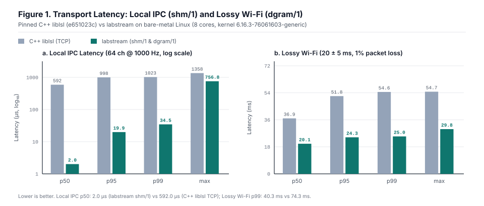
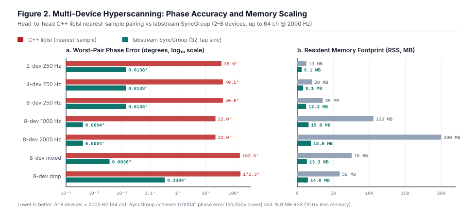
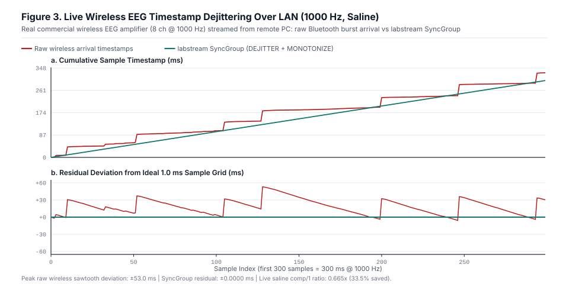
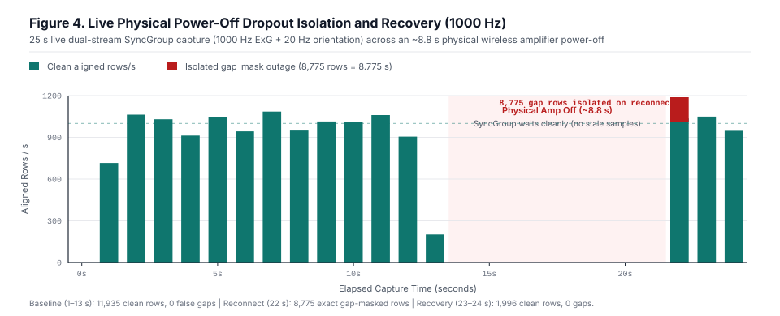

# Benchmarks and hardware validation

This page reports bare-metal benchmark results against a pinned build of C++
`sccn/liblsl` (`e651023c`) and live validation against a commercial wireless
Bluetooth EEG amplifier over a local area network.

All tests run on bare-metal Linux (8 cores, kernel `6.16.3-76061603-generic`)
with zero container overhead. The harness compiles each C benchmark worker
twice (`-O2`), once against `conformance/.build/install/lib/liblsl.so` and once
against `target/release/liblsl.so`.

## 1. Transport latency (`shm/1` and `dgram/1`)

- **Local IPC (`B1`):** 64 channels at `1000 Hz`, chunk size 1, outlet and
  inlet pinned to separate CPU cores with `taskset`. `labstream shm/1` lowers
  median latency from `592.0 us` to `2.0 us` and `p99` from `1023.1 us` to
  `34.5 us`.
- **Lossy Wi-Fi (`B3`):** 8 channels at `512 Hz` across an isolated Linux
  network namespace (`unshare -Urn` + `veth` + `tc netem delay 20ms 5ms loss
  1%`). `labstream dgram/1` lowers `p50` latency from `36.9 ms` to `20.1 ms`
  and `p99` from `74.3 ms` to `40.3 ms`.



## 2. Multi-device hyperscanning (`SyncGroup` vs C++ `liblsl`)

This suite runs 2, 4, and 8 simultaneous asynchronous devices (up to 64
channels) at `250 Hz`, `1000 Hz`, and `2000 Hz`, plus an 8-device mixed-rate
configuration (`1000 / 500 / 250 Hz` onto a `500 Hz` grid) and a `1.0 s`
single-headset dropout at `500 Hz`.

| Scenario | C++ `liblsl` Phase Error | `SyncGroup` Phase Error | `liblsl` CPU / RSS | `SyncGroup` CPU / RSS |
|---|---:|---:|---:|---:|
| 2-dev @ 250 Hz (16 ch) | 36.0 deg | **0.0138 deg** | 3.1% / 12.6 MB | **2.3% / 6.1 MB** |
| 4-dev @ 250 Hz (32 ch) | 40.5 deg | **0.0138 deg** | 4.6% / 20.3 MB | **3.7% / 8.1 MB** |
| 8-dev @ 250 Hz (64 ch) | 40.6 deg | **0.0138 deg** | 7.5% / 35.4 MB | **6.7% / 12.3 MB** |
| 8-dev @ 1000 Hz (64 ch) | 22.0 deg | **0.0004 deg** | 9.7% / 105.9 MB | **10.6% / 15.8 MB** |
| 8-dev @ 2000 Hz (64 ch) | 22.0 deg | **0.0004 deg** | 11.7% / 200.0 MB | **14.7% / 18.9 MB** |
| 8-dev mixed 1000/500/250 -> 500 Hz | 163.5 deg | **0.0036 deg** | 9.0% / 75.6 MB | **8.1% / 13.3 MB** |
| 8-dev @ 500 Hz + 1.0 s dev#4 drop | 172.3 deg | **0.3394 deg** | 8.5% / 58.9 MB | **8.0% / 14.8 MB** |

At 8 devices and `2000 Hz` (64 channels), `SyncGroup` holds `0.0004 deg`
worst-pair phase error and `18.9 MB` RSS versus `22.0 deg` and `200.0 MB` RSS
on C++ `liblsl`.



## 3. Live wireless EEG hardware validation over LAN

A commercial wireless Bluetooth EEG amplifier (8-channel `float32` ExG at
`250 Hz` and `1000 Hz`, plus a 13-channel `20 Hz` orientation stream) sent live
LSL streams from a remote desktop PC across a real LAN to `labstream`.

| Metric | 250 Hz (Open) | 1000 Hz (Open) | 1000 Hz (Saline, Un-railed) |
|---|---|---|---|
| **LAN Discovery** | 3 streams (auto) | 3 streams (auto) | 3 streams (auto) |
| **Burst Arrival (`p95`)** | `105.7 ms` | `42.3 ms` | `42.7 ms` |
| **Raw Step Error (`p99`)** | `85.6 ms` | `35.4 ms` | `35.7 ms` |
| **Live `comp/1` Wire Ratio** | `0.294x` (railed) | `0.293x` (railed) | **`0.665x` (33.5% saved)** |
| **Dual-Stream `SyncGroup`** | `250 + 20 Hz`: `0` gaps, `1.74%` CPU, `5.4 MB` | `1000 + 20 Hz`: `6,454` rows, `0` gaps, `3.49%` CPU, `6.4 MB` | `1000 + 20 Hz`: `6,451` rows, `0` gaps, `3.09%` CPU, `5.7 MB` |

Live `labstream relay --ws-port 8765` also forwarded `1,284` live EEG samples
(`52,692` bytes) over `ws/1` to a WebSocket client and returned `marker_ok =
true` on a browser-to-LSL marker round trip.



## 4. Live physical power-off dropout and recovery

During a 25-second `1000 Hz` dual-stream `SyncGroup` capture (`1000 Hz` ExG +
`20 Hz` orientation), the wireless amplifier powered off for ~8.8 seconds and
reconnected:

- **Baseline (`1–13 s`):** `11,935` aligned rows, `0` false gaps.
- **Amp off (`14–21 s`):** `SyncGroup` waited cleanly with no hang and no stale
  samples.
- **Reconnect (`22 s`):** `SyncGroup` isolated the exact `8.775 s` outage as
  `8,775` gap-masked rows (`NaN` + bit 0 set in `gap_mask`) and resumed live
  output.
- **Post-recovery (`23–24 s`):** `1,049` and `947` clean rows/s with `0` gaps.



## Reproduce locally

Build `labstream-capi` in release mode, then run the suites from the repository
root:

```sh
cargo build --release -p labstream-capi
python3 conformance/bench/run_bench.py
python3 conformance/bench/hypersync_bench.py
python3 conformance/bench/live_eeg_check.py --type EEG --secs 15
python3 conformance/bench/plot_results.py
```
