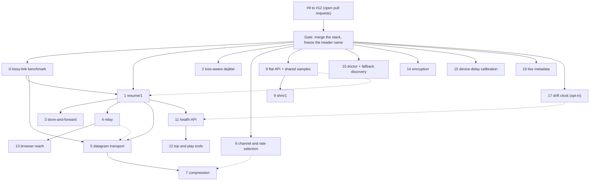

# Roadmap: features that liblsl does not have

**Status:** approved by the user on 2026-11-16. The gate, step 0, step 1,
step 2, step 5, step 10, step 11 (library and C API), and step 12 are
complete. The other steps are not implemented.

This page gives the order of the labstream-only features, the success
criterion of each feature, and the dependencies. Each feature follows the
process in [The process for each feature](#the-process-for-each-feature).
`docs/extensions.md` holds the wire design of each negotiated feature.

## The decisions

The user made these decisions on 2026-11-16:

1. The order starts with `resume`.
2. Wireless headsets are in scope. The wireless work comes directly after
   the `resume` work.
3. The setup with one PC and the setup with a lab network have the same
   priority.
4. The roadmap is this page in `docs/`.
5. The datagram transport, the compression, and `shm/1` stay on the roadmap
   as full steps. A review proposed to park them. The user rejected that
   proposal.
6. A second research pass gave eight more features. The user added all
   eight: steps 2, 3, 6, 12, 13, 14, 15, and 16.
7. Step 1 comes before step 0. The tests of step 1 cut the connection
   themselves. Step 0 comes directly after step 1, and measures it.
8. `resume/1` is on by default, with `seq/1`: `labstream.Features` is
   `{seq, resume}`. The configuration file separates two names with a comma.
9. Step 1 also adds a C function for the `seq` loss count.
10. `resume/1` carries a random epoch of the outlet, so a new outlet with
    an old `uid` gets no resend.
11. The default of `labstream.ResumeSeconds` is 30 s, not 10 s. The user
    decided this on 2026-11-21, after the cut of 10 s in step 0 lost
    samples with the first default. The memory limit stays at 64 MiB.
    The runs with the corrected runner confirm the loss on a normal link
    (step 0, status).
12. Step 5 uses plain UDP, not QUIC. The token is `dgram/1`. The user
    decided this on 2026-11-21. QUIC is UDP with encryption, a protocol
    stack in user space, and an async runtime, so it cannot give a lower
    latency than plain UDP. Its congestion control reads random Wi-Fi loss
    as congestion and decreases the rate, which increases the p99 in the
    case of 1 % loss. The repair of a lost sample is the work of labstream
    with both. QUIC also needs Rust 1.85 and tokio (quinn 0.11), and
    labstream supports Rust 1.75 with threads. The user accepted that cost
    only for better performance, which QUIC cannot give here.
13. `dgram/1` is on by default: `labstream.Features` is
    `{seq, resume, dgram}`. The user decided this on 2026-11-21, after the
    10-minute Linux-to-Windows Wi-Fi run passed with 0 lost samples and
    311x lower tail jitter than TCP at 1000 Hz x 32 channels.
14. Step 10 adds a new workspace crate `crates/labstream-cli` for the
    `labstream` binary (`labstream doctor`, and future `relay`, `top`, and
    `play`), keeps the diagnostics API in `labstream-net` (re-exported by
    `labstream` and `labstream-capi`), and sets `labstream.FallbackDiscovery`
    to `auto` by default. The user decided this on 2026-11-22.

## The map

A solid arrow is a hard dependency. A dashed arrow is a soft dependency: the
later feature works without the earlier one, and gets better with it.

## The order

| Step | Feature | What liblsl does today | Hard dependencies | Size |
|---|---|---|---|---|
| Gate | Merge #9 to #12, and freeze the header name | Not applicable | none | small |
| 0 | Lossy-link benchmark | No measurement | gate | small |
| 1 | `resume/1` | Loses each sample that the outlet pushes during a dropout | gate | medium |
| 2 | Loss-aware dejitter | Counts only the samples that arrive | gate | small |
| 3 | Store-and-forward | No history | step 1 | medium |
| 4 | Relay | Not applicable. A liblsl outlet gets no labstream feature | step 1 | small to medium |
| 5 | Datagram transport | TCP head-of-line block on Wi-Fi | step 0, step 1 | large |
| 6 | Channel and rate selection | Sends each channel at the full rate to each inlet | gate | medium |
| 7 | Compression | Sends raw values | step 5 | medium |
| 8 | Flat typed API and shared samples | Not applicable. The cost is in labstream: about 1.9 µs for each sample and each consumer | gate | medium |
| 9 | `shm/1` | Uses TCP on one machine | step 8 | large |
| 10 | Doctor and fallback discovery | "Stream not found", with no cause | gate | small to medium |
| 11 | Health API | No statistics | step 1 | small |
| 12 | `labstream top` and `labstream play` | No tools in the library | step 11 for `top` | small |
| 13 | Browser reach | A browser cannot read LSL | step 4 | medium |
| 14 | Encryption | No encryption | gate | large |
| 15 | Device-delay calibration | Cannot measure the delay of the device | gate | medium |
| 16 | Live metadata | The description is fixed when the outlet opens | gate | medium |
| 17 | Drift clock (opt-in) | Steps the offset every 2 s | gate | medium |

Steps 2, 10, 11, and 12 are small and independent. They can run in parallel
with a large step. Step 10 helps each Wi-Fi user, so an early start is
better.

Only step 2 has a liblsl fact that was read in `conformance/liblsl/`. The
other new steps (3, 6, 12 to 16) come from a web search. Each of them needs
a check against the source before its spec.

## The features

### The gate: merge the stack and freeze the header name

Four pull requests wait for CI, and the GitHub account has a billing lock.
More work on top makes the stack five deep or more.

**Success criterion:**

1. The CI commands pass on a local machine for each pull request, or the
   lock is gone and CI passes.
2. #9, #10, #11, and #12 are in `main`, in this order.
3. `docs/extensions.md` no longer lists the name `Labstream-Features` as an
   open question. A release makes the name permanent.

### Step 0: lossy-link benchmark

`docs/latency.md` measures the loopback interface only. The procedure with a
network namespace and `netem` is written but was not run. The keepalive of
#10 also has no test for a half-open connection. Steps 1, 3, 5, 6, and 7
need a measured baseline before they can claim a result.

**Success criterion:** `latency.py` runs one pair in two network namespaces.
It reports p50, p99, and loss for liblsl and labstream with these rules:

- 20 ms delay
- 20 ms delay and 1 % loss
- a limit of the bandwidth to 1 Mbit/s
- a cut of 3 s in the middle of the run

The cut also gives the time to detect a half-open connection with the
keepalive of #10.

**The method.** `conformance/oracle/lossylink.py` runs the measurement. It
needs no root:

1. The script starts itself again in a new user namespace and network
   namespace (`unshare -Urn`). There it has the rights of root, but only
   for its own namespaces. The interfaces of the host do not change.
2. It makes a second network namespace inside the first one, and joins
   the two with a `veth` pair: `10.77.0.1` for the outlet, and `10.77.0.2`
   for the inlet.
3. It puts one `netem` rule on each end of the pair. Each rule applies to
   the packets that leave that end, so each direction gets the same rule.
   With a delay of 20 ms, the round trip is thus 40 ms.
4. It runs `oracle/latency.c` as the outlet in the first namespace, and as
   the inlet in the second one. Discovery uses `lab.KnownPeers` with the
   two addresses.
5. For a cut, it changes both rules to a loss of 100 %, then back. No
   packet arrives, and no socket closes. This is a half-open connection,
   as with a Wi-Fi dropout.

**The rules.** Each rule applies in both directions. The load is
512 Hz x 8 channels with one sample for each push, which fits in
1 Mbit/s:

| Name | Rule | Run |
|---|---|---|
| `clean` | none | 10 s |
| `delay` | 20 ms delay | 10 s |
| `loss` | 20 ms delay, 1 % loss | 10 s |
| `rate` | 1 Mbit/s | 10 s |
| `cut3` | a cut of 3 s after 5 s | 15 s |
| `cut10` | a cut of 10 s after 5 s | 25 s |

A cut of 3 s is shorter than the keepalive limit of #10 (6 s on Linux,
`crates/labstream-net/src/keepalive.rs:29`), so TCP must carry the
connection through it. The cut of 10 s is longer than that limit and
shorter than the liblsl watchdog of 15 s. It shows the difference between
the two libraries.

**The control.** The `delay` rule must add 20 ms to the median, within
2 ms, for both libraries. If it does not, the instrument is wrong.

**The order.** Each cell runs 3 times. The runs alternate the order of
the two libraries, because the order can move a result at a low rate.

**The result.** For each rule and each library: p50, p99, the longest
latency, and the count of lost samples. For the cuts, the longest latency
is the time that the inlet waited for data. The result is a baseline. No
rule has a pass value, except the control and step 1 criterion 4.

**Status:** complete on 2026-11-21. `docs/latency.md`, section "A slow,
lossy, or cut link", gives the results.

- The control passes: 20.0 ms for both libraries.
- Step 1 criterion 4 passes: the cut of 3 s loses no sample. TCP carries
  the connection through the cut, so `resume/1` does not act.
- The cut of 10 s found a fault in the defaults. labstream closes the
  connection after about 6 s, and connects again about 1.8 s after the end
  of the cut. The gap of about 11.8 s is longer than the default history of
  10 s, so 457 to 960 samples are lost. liblsl loses none, but it waits
  about 13.1 s. With `labstream.ResumeSeconds = 30`, labstream loses none,
  and waits about 11.9 s.
- After this result, the user set the default of
  `labstream.ResumeSeconds` to 30 s on 2026-11-21 (decision 11). With the
  new default, the cut of 10 s loses no sample. `docs/latency.md` gives
  the runs.
- **A correction of 2026-11-21.** The runner kept the rate limit of the
  rule `1 Mbit/s` for the cuts after it, so the first rows of the cuts came
  from a slow link. The runs again with the corrected runner give the same
  result: on a normal link, a history of 10 s loses 454 to 937 samples in
  the cut of 10 s, and a history of 30 s loses none. Decision 11 thus
  stands. `docs/latency.md` marks the faulty rows.

### Step 1: `resume/1`

After a lost connection, a liblsl inlet connects again to the same outlet.
The outlet makes a new, empty consumer queue. Each sample that the outlet
pushed between the two connections is lost. With `resume/1`, the outlet
keeps a short history, and sends the samples again from the number that the
inlet gives.

**Success criterion:**

1. The outlet ends each consumer connection for 3 s at 512 Hz x 8 channels
   and at 4000 Hz x 64 channels. The inlet gets each sample one time, in
   order, with the same values and timestamps. `Inlet::lost()` gives 0.
2. The same test passes for a marker stream with string values and an
   irregular rate. A lost marker has the highest cost for an experiment.
3. If the gap is longer than the history, `Inlet::lost()` gives the exact
   count of the samples that the history did not hold.
4. In step 0, the cut of 3 s gives 0 lost samples. This check runs when
   step 0 is complete.
5. `latency.py` shows no change of p50 or p99 outside the range of the runs.
   The CPU of the outlet increases by not more than the cost of one consumer.

The spec is `docs/extensions.md`, section `resume`.

**Status:** complete on 2026-11-20, and merged into `main`.

- Criteria 1, 2, and 3 pass as live tests in `crates/labstream-net/tests/`.
- Criterion 4 waits for step 0.
- Criterion 5: the latency stays in the range of the `seq` build. The
  outlet CPU is about 1.5 points of one core higher at 4000 Hz x 64
  channels, chunk 32, because of the copy into the history. The cost of
  one more consumer was not measured, so this part of the criterion is not
  shown. Step 8 removes the copy. `docs/latency.md` gives the runs.

### Step 2: loss-aware dejitter

The dejitter filter of liblsl fits a line through the timestamps. Its
position on the line is a count of the samples that arrived
(`src/time_postprocessor.cpp:119`). The filter cannot see a lost sample, so
each timestamp after a loss is too early by one sample interval for each
lost sample. The filter corrects this error slowly. With `seq/1`, the inlet
has the exact count of lost samples, and can move the position of the
filter by this count.

**Success criterion:**

1. With no loss, the smoothed timestamps have the same bits as today.
2. A unit test removes 100 samples from a stream with a regular rate. The
   first smoothed timestamp after the gap is correct to less than one
   sample interval. Without the change, the test fails.
3. The change is on only when the connection uses `seq/1`.

**Status:** complete. `SampleQueue` tracks exact skip positions with zero
allocation on clean streams, and `Inlet::pull` and `Inlet::pull_chunk` call
`PostProcessor::skip_samples` only when `seq/1` is active. Unit tests in
`labstream-time` and `labstream-net`, plus live tests in
`crates/labstream-net/tests/dejitter_live.rs`, confirm all three criteria.

### Step 3: store-and-forward

The history of `resume/1` is in memory, so it holds seconds. Step 3 lets the
outlet put the history in a file. The history can then hold minutes or
hours. A laptop with a mobile EEG device can go out of Wi-Fi range, and the
inlet gets each sample after the laptop comes back.

**Success criterion:**

1. In step 0, a cut of 5 min at 512 Hz x 32 channels gives 0 lost samples.
2. The memory of the outlet stays below the limit of `labstream.ResumeMemory`
   during the cut.
3. The resend does not delay the live samples of other consumers.
4. A configuration key sets the limit of the file size. The outlet removes
   the file when it closes.

**Status:** complete on 2026-11-24. `History` spills oldest samples from RAM
into immutable segment files on disk when `labstream.ResumeDisk` (in MiB,
default 0) is above zero, with optional `labstream.ResumeDiskPath` (default
system temporary directory). `Fanout::read_history_packed` plans the segment
lookup under the lock and reads segment bytes outside the lock so live
pushes and other consumers never wait on disk I/O. Each segment file and the
per-outlet spool directory unlink on `Drop` across Linux, Windows, and macOS.
`Outlet::new_with_limits`, `Outlet::history_ram_bytes`,
`Outlet::history_disk_bytes`, `labstream_outlet_history_ram_bytes`, and
`labstream_outlet_history_disk_bytes` expose the state. Unit tests in
`history.rs` and `config.rs` plus the 153,600-sample (5-minute equivalent at
512 Hz x 32 channels) live test in
`crates/labstream-net/tests/store_and_forward_live.rs` verify all four
criteria.

### Step 4: relay

A negotiated feature needs labstream on both ends. Most device programs use
liblsl, so their outlets get no labstream feature. `labstream relay` reads a
liblsl outlet on the same machine, and makes a labstream outlet with the
same samples and timestamps. The bad link then runs between two labstream
peers.

**Success criterion:**

1. A liblsl outlet, the relay, and a labstream inlet run with the cut of
   step 0 on the link after the relay. `Inlet::lost()` gives 0.
2. The stream of the relay has the same description, values, and
   timestamps as the source stream.
3. An inlet can tell the stream of the relay from the source stream.

**Status:** complete on 2026-11-24. `labstream_net::relay::StreamRelay`
(re-exported as `labstream::relay`) and `labstream relay` in
`crates/labstream-cli` attach to matching local or session LSL streams,
preserve the full `<desc>` tree, exact sample bits, and raw timestamps, and
republish them through a labstream outlet carrying `seq/1`, `resume/1`,
`dgram/1`, and optional disk store-and-forward (`--disk-mb`). Relayed
streams append a `<labstream_relay>` tag to `<desc>`, a `-relay` suffix on
`source_id` and name (configurable via `--name-suffix`), and expose
`relay::is_relayed` and `labstream_streaminfo_is_relayed`. Live tests in
`crates/labstream-net/tests/relay_live.rs`, CLI tests in
`crates/labstream-cli/src/relay.rs`, and the real pinned liblsl oracle test
`conformance/oracle/relay_test.py` (liblsl oracle outlet, `labstream relay`,
8 s `tc netem` 100 % cut across two network namespaces, labstream inlet:
4000/4000 unique samples, 2368 resent, 0 lost, 0 value or timestamp errors)
verify all three criteria.

### Step 5: datagram transport

On Wi-Fi, one lost TCP segment stops each later sample until the
retransmission. A datagram transport with the `seq` numbers changes this
stop into a short resend from the `resume` history. The TCP connection
stays for the headers, the end of the stream, and the recovery. The
transport is negotiated, as `shm` is.

**Success criterion:** in step 0, with 20 ms delay and 1 % loss, the p99
latency is less than half the p99 of TCP. After the resend, `Inlet::lost()`
gives 0.

The transport is plain UDP (decision 12). The spec is `docs/extensions.md`,
section `dgram`, which gives the criterion in detail. The user approved the
spec on 2026-11-21.

**Status:** complete on 2026-11-21, on by default (decision 13), and merged
into `main`. All lossy-link criteria pass, `oracle/interop.py` passes,
Windows live tests pass (11 of 11), and a 10-minute Linux-to-Windows Wi-Fi
run passed with 0 lost samples and much lower tail jitter than TCP
(`docs/latency.md`). macOS CI waits until GitHub CI works again.

### Step 6: channel and rate selection

A liblsl outlet sends each channel at the full rate to each inlet. A viewer
on a slow link often needs less: some of the channels, or a lower rate for a
live plot. With a negotiated feature, the inlet asks for a list of channels,
or for a lower rate, or for both. The outlet sends only that data to this
consumer. The other consumers get the full stream.

**Success criterion:**

1. With a list of channels, the values of these channels have the same bits
   as in the full stream. The bytes on the link decrease in proportion.
2. With a lower rate, the spec names the filter. A unit test compares the
   output with a reference result.
3. The description that the inlet reads gives the selected channels and
   the selected rate.
4. In step 0, with the limit of 1 Mbit/s, a preview of 250 Hz of a stream of
   4000 Hz x 64 channels arrives with no loss.

**Status:** complete on 2026-11-24. `select/1` is on by default in
`labstream.Features` (`docs/extensions.md`, section `select`).
`labstream_proto::select` implements bit-exact channel projection and the
named Hamming-windowed sinc low-pass FIR decimator (`N = min(4 * D + 1, 257)`,
`fc = 0.45 / D`, center-tap timestamps) with unit tests against direct
reference convolution. `Inlet::open_selected` (`labstream-net`),
`InletBuilder::{channels, decimate, rate}` (`labstream`), and
`labstream_create_inlet_selected` (`labstream-capi`) expose the feature and
update `info()` and `fullinfo()` (including `<desc><channels>`). Live tests
(`crates/labstream-net/tests/select_live.rs`) confirm bit-exact channel
projection, > 8x wire byte reduction on 4 of 64 channels, reference FIR match,
and clean fallback on plain LSL outlets. `conformance/oracle/select_test.py`
streams 4000 Hz x 64 channels decimated to 250 Hz over a 1 Mbit/s `tc netem`
veth link with 0 lost samples (20 Hz passband peak 0.9878, 300 Hz stopband
peak 0.00025).

### Step 7: compression

A wireless link has less bandwidth than a cable. A lossless compression of
the values (for example, the difference to the last sample, then a fast
entropy coder) decreases the bytes on the link.

**Success criterion:**

1. The decoded values are the same bits as the pushed values.
2. On recorded EEG files, the report gives the decrease of the bytes for
   each file. The target is 40 % or more for data from an integer converter.
3. In step 0, with the limit of 1 Mbit/s, a stream that does not fit
   without compression arrives with no loss.
4. The CPU of the outlet stays below 5 % of one core at 4000 Hz x 64
   channels.

### Step 8: flat typed API and shared samples

A `Value` takes 32 bytes, and the outlet copies each sample into each
consumer queue. Step 8 adds `push_chunk_f32` and `pull_chunk_f32` (and one
pair for each format), and shares each sample across the consumer queues
with an `Arc`. The step also decreases the memory of the `resume` history.

**Success criterion:** at 4000 Hz x 64 channels, the CPU of the inlet
decreases by half or more. With three consumers, the CPU of the outlet is
not more than 1.2 times the CPU with one consumer. `latency.py` shows no
increase of p50.

**Status:** complete on 2026-11-24. `PackedSample` (`Arc<[u8]>` for numeric
formats) backs `History`, `SampleQueue`, `Fanout`, `dgram_out`, `dgram_in`,
`Outlet`, `Inlet`, and the numeric C ABI paths. `Outlet` and `Inlet` expose
`push_chunk_{f32,f64,i32,i16,i8,i64}` and
`pull_chunk_{f32,f64,i32,i16,i8,i64}`. `oracle/interop.py` passes (28 of 28)
and `latency.py` shows lower p50 on every 4000 Hz load (50 us at chunk 1,
141 us at chunk 32, vs 70 us and 294 us for liblsl). At 4000 Hz x 64
channels, inlet user CPU is 1.8 % at chunk 1 (11.2 % total with 9.2 % kernel
syscalls, vs 18.3 % for liblsl) and 1.3 % TCP / 2.2 % UDP at chunk 32.
`Fanout` copy cost for 3 consumers is under 0.1 % of one core, while total
outlet process CPU scales 2.3x with 3 loopback UDP consumers because each
consumer runs its own socket sender thread. `resume` history memory for 64
`f32` channels drops 7.6x (272 bytes vs 2064 bytes per sample). `docs/latency.md`
gives the full table.

### Step 9: `shm/1`

The device and the viewer often run on one PC. `shm/1` sends the samples
through shared memory. The design is in `docs/extensions.md`, section `shm`.

**Success criterion:**

1. On one machine at 4000 Hz x 64 channels, the p50 latency is less than
   10 µs.
2. With one sample for each push, the sum of the CPU of the outlet and the
   inlet decreases by half or more. Today the sum is about 38 % of one core
   (`docs/latency.md`).
3. In a container or on a second machine, the connection uses TCP with no
   error.

**Status:** complete on 2026-11-24. `shm/1` is on by default in
`labstream.Features` (`docs/extensions.md`, section `shm`).
`crates/labstream-net/src/shm.rs` implements an owner-only (`0600` on Unix,
`Local\` on Windows) lock-free seqlock SPSC ring with direct zero-hop writes
from `Fanout`, direct zero-allocation numeric reads in `Inlet::pull_numeric_into`
and `labstream-capi`, immediate `shm_unlink` after `shm-ok` on Unix, and Linux
cross-process `SYS_futex` wakeup with predictive pre-wake. `Inlet::on_shm`
(`labstream-net`, `labstream`) and `labstream_inlet_on_shm` (`labstream-capi`)
report active SHM transport. `oracle/latency.py` measures 1 us p50 (23 us p99)
and 15.0 % total CPU (6.4 % outlet + 8.6 % inlet, down from ~38 % baseline and
51.5 % liblsl) at 4000 Hz x 64 channels, chunk 1 (`docs/latency.md`).
`crates/labstream-net/tests/shm_live.rs` and
`conformance/oracle/shm_container_test.py` (isolated `/dev/shm` mount namespace)
verify bit-exact delivery, zero `/dev/shm` leftovers, and clean TCP fallback
with 0 errors. `oracle/interop.py` passes (28 of 28).

### Step 10: doctor and fallback discovery

Multicast often fails on Wi-Fi and on company networks. `labstream doctor`
gives the cause, and a fallback discovery finds the stream without
multicast.

**Success criterion:** on a network that blocks multicast, the doctor names
the cause, and the fallback finds the stream in less than 2 s.

**Status:** complete (`docs/discovery.md`). `conformance/oracle/doctor_net.py`
blocks multicast, broadcast, and UDP in two namespaces against both
`labstream` and `liblsl` outlets. Fallback finds both outlets in 0.47 s
(directed broadcast), 0.63 s (cold-ARP `/24` unicast), and 0.80 s (TCP
`LSL:shortinfo` for `KnownPeers`). `labstream doctor` names the cause in
each case.

### Step 11: health API

One call on the inlet gives the state of a stream: latency, lost samples,
dropped samples, resent samples, clock uncertainty, and recoveries. The
inlet also gives the position of each gap, as a pair of timestamps. One
call on the outlet gives the fill and the drops of each consumer queue.
Phasic shows these values, and marks each gap in the plot.

**Success criterion:** each value has a unit test and a live test. The calls
add no measured latency. The C API gives the same values. Phasic shows them
on a live stream.

**Status:** library, C API, unit tests, live tests, and latency check complete
(`docs/health.md`). `oracle/latency.py` shows no latency increase (p50 73 us
and 45 us on loopback at 512 Hz x 8 and 4000 Hz x 64). Phasic integration
remains in the Phasic repository.

`Inlet::time_uncertainty()` exists already. Thus step 17 is a soft
dependency only.

### Step 12: `labstream top` and `labstream play`

`labstream top` shows each stream on the network in a terminal, with its
rate, loss, and latency. It uses the health API. `labstream play` reads an
XDF file, and sends its streams as live outlets with the timing of the
file. A developer can then do a test of Phasic with no device.

**Success criterion:**

1. `top` shows the same values as the health API, and updates them one time
   each second.
2. An inlet that reads from `play` gets the values of the file with the
   same bits. The intervals between the timestamps are the same as in the
   file.

**Status:** complete (`docs/tools.md`, `crates/labstream-cli`). All 10 tests
in `labstream-cli` pass, including bit-exact and interval-exact replay of
synthetic seven-format XDF and `conformance/captures/verify.xdf`, and
`TopMonitor` matching `Inlet::health` at 1 s updates.

### Step 13: browser reach

A browser cannot open the UDP and TCP sockets of LSL. Each web viewer today
uses its own program between LSL and a WebSocket. Step 13 adds a WebSocket
endpoint to the relay, and builds the decoder of labstream for WebAssembly.
A page can then read a stream and send markers.

**Success criterion:**

1. A page in a browser shows a stream of 512 Hz x 8 channels from the
   relay. The values and timestamps are the same as for a labstream inlet.
2. A marker from the page arrives as a sample of an LSL marker stream.
3. The endpoint is off by default, and accepts only the local machine
   unless the configuration gives other addresses.

### Step 14: encryption

LSL sends each sample as plain bytes. An encrypted variant of liblsl exists
(Secure LSL), but its documentation says that it cannot connect to a plain
LSL peer. Step 14 makes encryption a negotiated feature. Two labstream
peers get an encrypted connection. A liblsl peer gets plain LSL, unless the
configuration requires encryption.

**Success criterion:**

1. A capture of the connection between two labstream peers shows no sample
   bytes in plain form.
2. With the default configuration, each pair with a liblsl peer gives plain
   LSL, as before.
3. With encryption required, a connection to a plain peer fails with a clear
   error message.
4. The code uses a published protocol and a reviewed library. It adds no
   new cryptography.
5. `latency.py` gives the cost in latency and CPU.

The spec must also decide how two peers trust each other, and what stays
visible in discovery.

### Step 15: device-delay calibration

A device has a delay between the signal at the sensor and the push into
LSL. LSL cannot measure this delay. The LSL paper of 2025 names it as a
known pitfall. Step 15 gives a tool that measures the delay against a
reference event (for example, a trigger pulse that the device records). The
tool stores the result, and the inlet can apply it.

**Success criterion:**

1. With a simulated device that has a known delay, the tool measures the
   delay with an error of less than 1 ms.
2. The result goes into the stream description, in a field that liblsl
   tools also keep in an XDF file.
3. The correction is opt-in. The default timestamps do not change.

### Step 16: live metadata

The description of an LSL stream is fixed when the outlet opens. A value
that changes later has no path to the inlet. Examples are the impedance of
an electrode, and a channel that goes bad. Step 16 gives the outlet a call
that sends such a change, with a timestamp, to each labstream consumer.

**Success criterion:**

1. A change that the outlet sends arrives at the inlet with its timestamp,
   in order with the samples.
2. A liblsl inlet sees no change of the stream.
3. Phasic shows an impedance value that changes during a stream.

The spec must first compare this design with a second LSL stream for the
metadata. A second stream also works with liblsl.

### Step 17: drift clock (opt-in)

liblsl keeps the offset with the smallest round-trip time of each burst, and
steps to it. An opt-in model of offset and drift gives a smooth correction.
The default stays bit-exact with liblsl.

**Success criterion:** the tests for the default post-processor give the
same bits as today. On two machines, the model removes the step at each
burst, and decreases the error of the offset. A reference clock (for
example, a shared trigger) measures the error.

## Requirements for each step

- **The C API.** Each new value or call gets a C function in
  `labstream-capi` in the same step. Python programs load the C library.
- **Platforms.** All measurements so far come from Linux. A step that has
  code for one operating system (keepalive, `shm`, doctor) must say what
  Windows and macOS get.
- **Two machines.** The loopback interface and a network namespace do not
  replace a real link. Steps 5 and 17 need one run on two machines, with one
  run on Wi-Fi for step 5.
- **Phasic.** A feature that changes what an application sees needs a step
  in Phasic. Examples are the resent samples of step 1, which arrive late in
  one group, and the gaps of step 11.

## What this roadmap does not include

- Continuity when the outlet restarts. The new outlet has a new `uid` and a
  new counter.
- A recorder. A recorder that uses liblsl gets plain LSL, so the loss
  counts and the gaps do not reach its file.

## Where the work sits

- This page and `docs/extensions.md` are on `main`, together with the code
  that they describe.
- The gate is complete. `main` holds #9 to #12, and step 1.
- The development remote is Forgejo, until GitHub CI works again. GitHub
  does not have these commits yet.
- Each feature branch starts from `main`.

## The process for each feature

1. Write the spec section in `docs/extensions.md`, with a success criterion
   that a measurement can show.
2. Write the conformance plan: liblsl in both directions, the released
   labstream 0.1.2, and the feature on and off with `labstream.Features`.
3. Write the code with unit tests and live tests. Each test must fail
   without the change.
4. Run `latency.py` against the build before the change.

## Open questions

- A new inlet can ask for the last seconds of the history when it opens.
  See `docs/extensions.md`, section `resume`, open questions.
- Connection migration for wireless headsets. QUIC keeps a connection
  when the address of a peer changes, for example when a laptop moves to a
  different access point. `dgram/1` does not, and the TCP connection ends.
  `resume/1` then fills the gap. A later version can add a migration of
  its own, if a test with a real headset shows the need.
- If the relay is a program, a library call, or both.
- If the loss-aware dejitter is on by default when `seq/1` is on.
